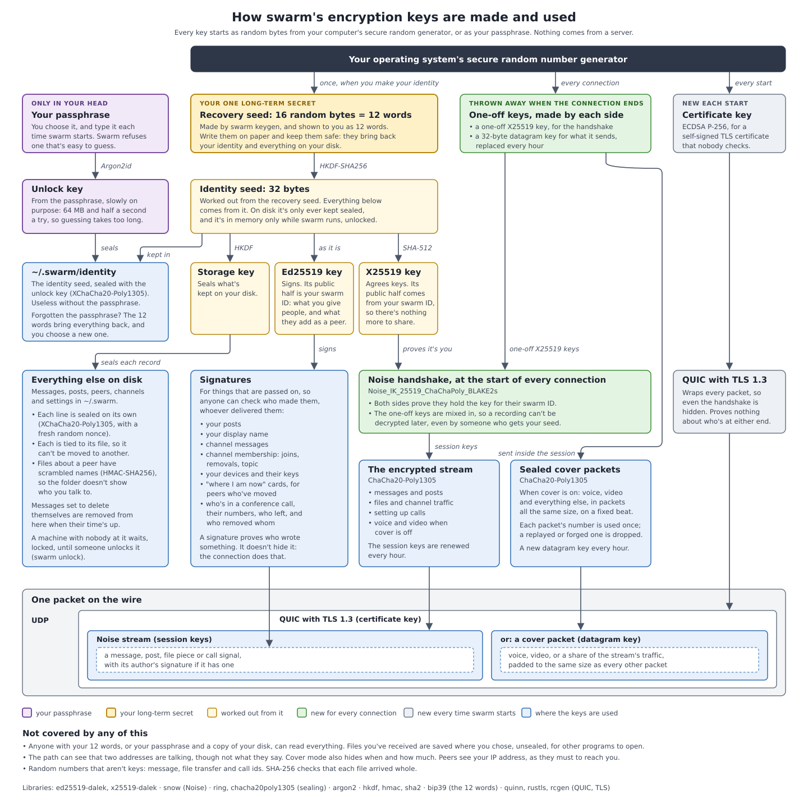

<!--
Swarm's manual: the Help tab in every version of Swarm (built into the
program by app/src/manual.rs), `swarm manual`, and the Word copy
(tools/manual-docx.py). British spelling.

- # chapter, ## section, ### subsection: numbered as they come (1, 1.1,
  1.1.1), so never type a number. #### is a heading of its own, not
  numbered.
- Each line is a paragraph of its own.
- **Term** – text: a term and what it is. `code`: a command, key or path.
- - a bullet; two spaces then - a bullet under it; 1. a numbered step.
- A line all in backticks: a command on a line of its own.
- | a | b |: a table, its first row the headings (a | --- | line under it).
- : a picture, from this folder (list it in
  manual.rs's PICTURES).
- [[Title]]: a link to that chapter or section, shown as its number.
-->

# Introduction

## Overview of Swarm
Swarm is an open source, serverless communications application. It is written in Rust, and connects directly to other Swarm users by IP address (IPv6 or IPv4) or domain name.
It does messages, posts, group chats, file transfers, voice and video calls, calls with several people, screen sharing and control of a shared screen, all end-to-end encrypted, with nothing in between but the network.
It works best over IPv6, which gives end-to-end connections without network address translation (NAT), and works over IPv4 too. A device behind an IPv4 NAT router can still reach out and be reached once it has, and your own devices can pass connections on for each other when one of them can't reach a contact directly (see [[Network traffic]]).

## Key features
The core architecture of Swarm is that no server is used. Communications go directly between two people's devices without passing through a server. The result is extremely fast and responsive calls, no server as a single point of failure, and no server as a central point of data collection. There are no accounts, no usernames and no phone numbers: your identity is a key that you hold.
Encryption is fundamental in every part of the program, both on the network and in local storage. Everything Swarm keeps on disk is locked under your passphrase.
Other key features:
- One identity on up to 8 devices (computer, laptop, phone). Contacts see one person; messages reach every device and calls ring every one.
- Messages wait on your device and go by themselves when the contact comes online.
- Messages that delete themselves after an hour, a day or a week.
- Group chats made from a chat by adding people, with no server holding them: anyone in one adds their own contacts.
- Voice and video calls up to 4K, using the graphics chip where there is one, with H.265 where both ends support it.
- Conference calls, voice and video, where people who aren't each other's contacts can still hear and see each other through someone in the call who is a contact of both.
- Screen sharing, and control of a shared desktop's mouse and keyboard with permission.
- File transfers of any size that carry on after a break and are checked on arrival.
- Cover mode, which hides when and how much you are communicating.
- A window, a terminal interface and a command line, all with the same features.

## Example usage
Corporate workplaces. Each person can run Swarm and have their co-workers added as contacts. Calls can then be made instantly around the workplace, including video, screen sharing and remote control. Other people can be added to a call for a conference call. On an office network with only private IPv4 addresses (192.168.x.x and so on), Swarm works as a self-contained communications tool with no internet connection needed.
Remote workers who have a VPN back into their company can also make calls. As long as there is IP connectivity between the two endpoints, Swarm will work. If a phone on a VPN can reach your desktop but not a colleague, the desktop can pass the connection on (see [[Device profile]] and [[Network traffic]]).
Because there is no server, there is no added latency. Response time is therefore extremely fast and very close to natural conversation.
Another advantage of being serverless is for use in highly sensitive government areas: there is no third party holding any data, no account to subpoena and nothing to configure. The program is a single executable file with no installation (the Android version is a normal app).
Home and family. A Raspberry Pi left running at home can keep messages flowing and answer calls from chosen people by itself, for example as a baby monitor (see [[Answering by itself]] and [[An always-on Swarm (Raspberry Pi or server)]]).

## System Requirements
Swarm is built for:
- Linux on x86-64 computers (swarm)
- Linux on 64-bit ARM, such as a Raspberry Pi 4 (swarm-arm)
- Windows 10 and later (swarm.exe)
- Android 8 and later (the Swarm app)
Video calls, screen sharing and remote control work on Windows and on both X11 and Wayland Linux desktops. A phone can share a call's video but its screen is never controlled.
Video uses the graphics chip where there is one: NVIDIA (NVENC/NVDEC), Intel and AMD on Linux (VA-API), Windows' Media Foundation, and the phone's own hardware encoder. Without one, video is done by the processor.
Swarm uses UDP port 1977 by default.

# Getting started

## Initial use
When first starting Swarm, it asks: "Is this your first device with Swarm, or are you already on Swarm on another?" There are two choices.

#### New user
- Type your name (optional). This is the name your contacts see beside your key. You can change it later.
- Choose a passphrase. You type it every time Swarm starts. Swarm refuses easily guessed ones (such as password1 or Fluffy2019!) and says why. Four or five random words, or a sentence of your own, works well. Suggest a passphrase gives you five random words.
- Write down your 12 recovery words. They are shown once. Put them on paper somewhere safe and private. Copy the words puts them on the clipboard to paste into a password manager; copy something else afterwards, as other programs can read the clipboard. Press I've written them down to carry on.

#### Add this device to my user
Use this if you are already on Swarm on another device (see [[Device profile]]). On the other device, in the Contacts tab, choose Add a device, at the end of your devices under you. It shows a code as a QR code with a line of text under it. On the new device, paste the line or press Scan a QR code and hold the code up to the camera. Give this device a name if you like and choose its passphrase. The two devices then connect, the new one is added to your list of devices, and it fetches your contacts and chats.
If you have no other device to hand, use Bring it back and type your 12 words instead (the first four letters of each word are enough). You get the same identity back, so your contacts don't need to add you again.

Your identity belongs to you, not the device. Each device you add gets your identity plus a device key of its own, so one person can be on a desktop and a phone at the same time. Up to 8 devices can belong to one user, and any of them can receive calls.

## Accessing the program
The program is a single executable file. Start it with swarm (or swarm.exe on Windows, swarm-arm on a Raspberry Pi) and it opens the window, the graphical user interface (GUI). Use `swarm --tui` to open the terminal user interface (TUI), for when only a terminal is available. Swarm uses the TUI by itself when there is no screen to open a window on, for example over ssh.
Only one Swarm runs on a device at a time. Starting a second one says "swarm is already running on this device".

#### Graphical User Interface (GUI)
The window, with tabs along the top, the list of contacts and groups on the left and the open chat on the right. Everything can be clicked, and most things also have a key (see [[Reference]]).

#### Terminal User Interface (TUI)
The same layout drawn with text. Move with the Up and Down arrows, press Enter to start typing, Esc to stop typing or go back, and use letter keys for everything else. The keys you can press right now are always listed along the bottom. Video calls work in the TUI too, drawn with coloured text characters.

#### Command line
Every feature also has a command, for scripts and for computers with no screen at all (see [[Reference]]).

## Unlocking the program
When starting the program with an existing user, the "Swarm is locked" screen asks for your passphrase. Nothing is sent or received until you unlock it.
Forgotten it? Underneath, type your 12 recovery words and choose a new passphrase. Nothing is lost.
If Lock when left is turned on (see [[General]]), Swarm locks again after a time with nobody using it. It keeps running underneath, so messages and calls still arrive.

## User interface overview
- Along the top: the tabs Contacts, Chats, Transfers, Settings and Help, and the call while you are in one.
- On the left: the list, under three headings:
  - **YOU** – yourself: your name, status, picture and posts.
  - **CONTACTS** – anyone asking to be added first, then your contacts, then people you follow.
  - **GROUPS** – the groups you are in.
  - Click a heading's triangle to close or open it. A closed heading shows how many are under it, with a dot if any of them has something unread or waiting. It stays as you left it. A chat you read on one of your devices stops showing as unread on the others, as long as you are really using that device: a window left open on a computer you have walked away from doesn't count.
  - In the window, drag the line between the list and the middle to make the list wider or narrower. Drag it almost to the left edge, or click the ‹ half way down the line, and the list narrows to a strip of pictures, giving the rest of the window the room; how many messages are unread shows on each picture's corner, and a name shows with the mouse over its picture. Click the › (or drag the line out again) to widen it. A double-click on the line does the same, and in a chat x does too. The list stays as you left it.
- In the Contacts tab, each heading ends with a way to add to it: Add a device under your devices, Add a contact and Follow someone under CONTACTS, New group under GROUPS.
- In the middle: whatever is selected – a chat, someone's posts, a group. In the Help tab, the list holds the manual's chapters and the middle its pages (see [[Help tab]]).
- Along the bottom: the status line (what just happened).
Each contact has a ring round their picture showing whether they are online: green online, grey offline, and orange while something waits on an answer – someone asking to be added, a contact who hasn't added you yet, or one who has removed you.

## Contacts
The Contacts tab shows the information of each of your contacts. The top entry is yourself, with your devices hanging beneath you (see [[Device profile]]). The list shows your contacts' names with the start of their public key beneath.
Below your contacts are anyone you follow, then the groups you are in.
When someone asks to add you as a contact, the request appears at the top of the contacts in the list.
Selecting a contact shows their details: name, key, addresses, status, whether they are online and how the connection was made, their cover rate and where their files go. **They see you at** is the address your connection to them came from, as they saw it: behind a router, its public address. Three choices follow:
- **their calls** – ring as usual, or answered automatically, voice only or with video too (see [[Answering by itself]]).
- **May control your screen without asking** – a tick lets them see and use your screen as soon as they ask during a call, with no Allow to press: it's shared with them if it isn't already (see [[Allowing remote control of desktop]]). Not on a phone, which is never controlled.
- **messages** – kept, or deleted after an hour, a day or a week, on both sides (see [[Messages that delete themselves]]).

Under the address shown is a field holding it, with **Set address**, the same as for one of your own devices (see [[Device profile]]): change it and press Set address (or Enter) to try them there at once. Give an IP address or a host name, with `:port` if it isn't 1977; several are separated by commas. A host name (from a dynamic DNS service, say) is looked up afresh each time they're dialled, so they're still found when the IP behind it changes. The lookup never holds up their other addresses: its last answer is used while it's looked up again, and kept when the lookup can't be done (no DNS for a while). Their code, pasted in, gives the addresses in it; someone else's changes nothing. It reaches your other devices. In the terminal, press i with them selected.
Under them are Chat, Call, Video call, Send a file and Edit…, and on the right Delete…. Edit… changes their name, address, key and cover rate, and also chooses a folder for their files to be saved in without asking (see [[File transfers]]).
A name is only a label: two contacts can have the same one, since each is really their key. In lists where you have to pick one of them, they are told apart by a bit of their key, as Bob~Ab3xYz, and typing that form works too. A rename on one of your devices reaches the others. To go back to the name they go by, clear the name in Edit… and save: they're called what they call themselves again, and it follows them when they change it, as when you add someone without a name. That reaches your other devices too.

#### Requests
Someone who has added you, but whom you haven't added, appears as a request. Choose:
- **Add them…** – add them as a contact (you are asked what to call them).
- **Dismiss** – remove the request. It comes back if they ask again.
- **Block…** – you won't hear from them again (you are asked first).
Dismiss and Block… are on the right, away from Add them….
Until you add them, anything they send waits on their device: you don't receive messages from people you haven't added.
A request reaches whichever of your devices they connect to, and is shown on all of them; what you choose on one is done on the others too.

#### Deleting a contact
Delete… asks whether to delete them or block them:
- **Delete** – everything Swarm keeps about them goes, on all your devices: your chat with them, messages still waiting to go to them, their posts, name, status and picture, where they can be reached, what you set for them and your file transfers with them. Files they sent you stay where they were saved, and their messages in groups stay with the group. Nothing of them is left, so they can ask to be added again later.
- **Block** – the same, but their key is kept, with the name they last gave, so they can't ask again. Blocked keys are listed at the foot of You (see [[Your information]]).
Your other devices are told, and delete them too. Until each of them has heard, a line saying they were deleted is kept; then that goes as well.
If you asked to add someone and they haven't accepted, the button says Cancel request… instead: it does the same, and also takes your request off their list. If they're away, your devices keep trying until one reaches them, for up to 30 days; until then their key and addresses are kept for that alone.
If they're connected when you delete them, they're told you've removed them. If someone removes you, their row says "has removed you" and nothing more goes to them; OK deletes them from your list too. If they add you back, the row returns to normal by itself.

## Your information
If you click your own name in the Contacts tab you see your own information. You can change here:
- **Your name** – shown to others beside your key.
- **Your status** – a few words beside your name, such as where you are or whether you're free. Only your contacts see it.
- **Your picture** – shown beside your name, and in a call while your camera is off. Only your contacts see it. Its middle square is kept, small.
- **Manually set IP address** – where you can be reached that no device of yours can see for itself: typically your router's public IPv4 address, with a port forwarded to one of your devices, or a host name for it (from a dynamic DNS service, say, so it keeps working when the address changes). Add `:port` if the forwarded port isn't 1977; several are separated by commas. It's yours, not one device's: set on one device, it's on all of them. It goes first in your code wherever you show it, so someone who scans your phone's code at a friend's house still gets your home address, and the IPs in it are told to your contacts along with each device's own addresses (a host name goes in the code only).
- **They see you at** – where your contacts see your connections come from, when it isn't one of this device's own addresses: behind a router, that's its public address. It shows only once you've connected to a contact outside your own network. Use this puts an address in the field above, for you to check (and add a port to) before Set. In the terminal interface, i (with yourself selected) sets your manually set address, starting from the first of these when there's none yet; `swarm address <address>` sets it from the command line.
- **Discoverable on this network** – on unless you turn it off. While it's on, each of your devices tells anyone on the same network (at home, at work, on the same Wi-Fi) that you're there: your name, your key, and that device's address on that network, nothing more (not which device it is, nor its name). They see you under Discover locally advertised contacts, in their Add a contact (see [[Add a contact]]), and can ask to add you; you still choose whether to accept. It's yours, not one device's: set on one device, it's on all of them. Turned off, your devices say goodbye at once, and they say goodbye too whenever Swarm stops. In the terminal interface, d (with yourself selected) turns it on or off; `swarm discoverable on` or `off` from the command line. On a phone, Swarm holds Wi-Fi's multicast lock while it's on, which costs a little battery.
Your current IP addresses and public key (your Swarm ID) are shown here. Global IPv6 and public IPv4 addresses are listed first, then local ones.
Your key, addresses and name are also shown as a QR code. This makes it easy for people to add you as a contact by scanning it. Tap or click the code to show it as big as the screen allows, which is easier to scan from across a room; tap again, or press Esc or Back, to close it. Any QR code Swarm shows, a contact's or the one for adding a device, opens the same way. Anyone who sees the code, in a screenshot or a video call for example, sees your addresses, your manually set one included, wherever you are when you show it.
Swarm listens on UDP port 1977 by default. `swarm listen --port <number>` uses another.
**Blocked keys**, at the foot, lists everyone you've blocked: the name each last gave, and their key. They are told they're removed whenever they connect, and are never shown asking to be added. Unblock lets one ask to be added again; adding them does the same. In the terminal interface, b unblocks one.
Your name proves nothing (anyone can call themselves "alice"): the key is what counts.

## Add a contact
In the Contacts tab, each heading of the list ends with a way to add to it:
- Add a device, at the end of your devices (see [[Initial use]])
- Add a contact, and Follow someone (see [[Posts and following]]), under CONTACTS
- New group (see [[Starting a group]]), under GROUPS

Contacts are added by their public key, which is their identity. An IP address (or domain name) is also needed. Several addresses can be given, separated by commas; they are tried in turn. The name shown is the one they give themselves, or you can type a different name for them here (only you see it). The cover rate is optional and sets constant traffic that hides when real traffic is flowing (see [[Cover privacy]]).
The quickest way is their code: a line starting `swarm:` that holds their key, addresses and name. They find it under You in their Swarm, with its QR code. Paste it into Their code, at the top of Add a contact, and the fields below fill themselves in; check them, then press Save. If they're nearby, they can show the QR code instead, and Scan a QR code reads it. In the terminal, paste the code at the address step.
Add a contact and Follow someone take the whole of the right-hand side. Under the form, **Discover locally advertised contacts** lists everyone on the same network as this device who is discoverable (see [[Your information]]): their name, the start of their key, and their addresses here. Someone with several devices on the network is one row. Add (or Follow) puts their code in the form, which fills itself in; check it and press Save. People already in your contacts are at the end, greyed; your own devices and anyone you've blocked aren't shown. Swarm only looks while the form is open. In the terminal, press Tab at the address step to put the next one's code in (Shift+Tab the one before), then Enter.
Anyone on a network can claim any name. A key found this way is checked when you connect, as any key is, but whether it's really your friend's is for you to tell: if in doubt, ask them to read you the start of their key.
If a contact has moved and can't be reached, ask them for their code again. Choose Edit… on them and paste it into Their new code: it fills in their new addresses, and keeps the name you have for them. A code for someone else changes nothing. In the terminal, paste it at the address step of `u`.
Both of you have to add each other. Once they have added you too, they show as online whenever their Swarm is running.

Send your key by a route you trust: in person, in a message where they know it's really you, or on a call. Swarm can't tell whether a key you were given was swapped by someone on the way.

When you or a contact change network (home Wi-Fi to mobile, say), Swarm tells your contacts where you can be reached now, and finds them again where it can. You don't need to update addresses by hand.

# Chats tab

If you select yourself, the area on the right shows your posts, and you can write new ones. Each is either for anyone (Post to anyone) or for contacts only (Post to contacts).

If you select one of your contacts, the chat area on the right shows the conversation with that contact. Each message shows when it was sent. Where the chat is narrow, as on a phone held upright, the name and time go on a small line above a message and the message has the whole width; several messages in a row from the same person, each within five minutes of the last, show the name once. Where there's room (the window, a phone on its side, a car's screen) each line has its time and name beside it. If the contact is offline, your message waits on your device and goes by itself when they are back.

A web address in a message (one starting http:// or https://) is underlined as a link: click it, or tap it on the phone, to open it in your usual browser. Nothing else in a message opens anything. A line with a link in it can still be selected with the mouse and copied (Ctrl+C), as long as you start away from the link itself, or long-pressed on the phone to copy it; in the window, right-clicking it and choosing Copy copies it whole, link and all. While it's selected, a link shows as plain text. In the terminal, most terminals open web addresses themselves (often Ctrl+click).

At the bottom is the area to type your message. Press Enter to send. Tab finishes a name you've started: in Harrison's chat, har then Tab gives "Harrison ", ready to type on. Where more than one name fits, Tab again gives the next. It works with your own name too, and in a group with its members' names. Where no name fits, Tab does what it always does (their Posts). Phones have no Tab key.

Above the chat is whom it's with, and on the right its buttons:
**Call** – starts a voice-only call to the contact (video can be started later during the call).
**Video call** – starts a call with both microphone and camera on.
**Add to call** – while you are in a call, in place of those two: rings them into it.
**Send a file** – lets you choose a file to send to the contact.
**Add people…** – starts a group of you, them and whoever you choose (see [[Group chats]]).
**Maximise** – (TUI) makes the chat fill the screen (also x); Restore puts it back. In the window, narrow the list instead (see [[User interface overview]]).
Switching between their Chat and their Posts shows the posts they have made. Whether messages delete themselves is set in their details in the Contacts tab (see [[Messages that delete themselves]]); the chat's heading says so while it is on.

Typing /me and something after it, in any chat, says what you are doing: "/me waves" shows as "Owen waves", in a colour of its own.

- On the phone, a tab's list fills the screen and what you tap opens over it. Moving between Contacts, Chats and Transfers keeps it open: someone's details, then their chat, then their files.
If you use Swarm on several devices, every message you send from one of them appears in the chat on the others too. A device that was off while you chatted gets the conversation when it next comes on, and puts it in the order it was said, by when each message was sent, so their messages and yours are interleaved as they were. (A message arriving as it's sent goes at the bottom, whatever the two clocks say, so a reply never shows above what it answers.)

In the window, the chat is selected with the mouse as in a text editor. Press on a message and drag, over as many lines as you like: what's selected runs from the character you pressed on to the one you let go on, and only the messages' text is highlighted. A double click selects a word (drag on to select more, a word at a time), a triple click a whole message, and Shift and a click carries the selection on to there. Ctrl+C, or a right-click and Copy, copies it: the messages alone, one to a line. Press on a time or name instead and drag, and whole lines are selected; copied, they come with the day's heading and each line's time and name, one to a line: "--- Tuesday 24 November 2026 ---", then "21:03 Harrison: evening", and so on. Dragging past the top or bottom of the chat scrolls it. A click anywhere in the chat, or Esc, lets go of the selection. With nothing selected, right-clicking a line offers Copy (its text alone, a link and all) and Copy with time and name.

Each message you send has a small, faint mark after it: ◷ while it is waiting to go (they're offline, say), and ✓ once it has reached them, on any one of their devices. It is the same on all your devices, whichever you sent it from. It never says whether they have read it.

Any line of a contact's chat can be deleted, however old, without being asked first. In the window, right-click it (anywhere on it, its ◷ or ✓ too) and choose Delete. On the phone, hold your finger on it and choose Delete (or Copy). In the TUI, while typing, Up picks the newest line and Up again older ones (Down goes back), and Delete deletes the one picked; Esc goes back to typing.
- **A message you sent** goes from their chat as well as yours, on all your devices and all of theirs. If it had reached them (✓), it stays in your chat, faint, with ◷, until one of their devices has heard (they're offline, say); then it goes. If it hadn't reached them yet (◷), it goes at once and never will reach them. They aren't told anything: it's just gone.
- **Their message, or a missed call,** goes from your chat at once, on all your devices. It stays in theirs.
A call from a contact that nobody answered, on any of your devices, shows in their chat as "Missed call from Owen", in a colour of its own, and counts as unread. A call answered on another of your devices isn't one.

# Transfers tab

This tab shows which files have been sent to or received from your contacts, with how far each one has got.
If you select yourself in the contact list, you see all files in and out.
Selecting any contact shows only the files between you and that contact.
From here a file waiting for you can be accepted or declined, and one in progress can be cancelled (see [[File transfers]]).
A finished one (delivered, saved, declined, cancelled or failed) has Clear, which takes it off the list; Clear all, above the list, clears every finished one listed (with a contact selected, only theirs). A file you received stays where it was saved. Clearing is on this device only. (TUI: l clears the selected one, L all.)

# Settings tab
In the window, hold the mouse over a setting's name to see what it does (tap it on a phone). In the TUI, move with Up/Down and press Enter to change one.

## General
**Colours** – Light, dark, or as the system has it. The terminal UI goes by it too.
**Text size** – Select the text size, from 90% to 200% (the window and the phone app; the TUI goes by the terminal's own). Ctrl + and Ctrl − change it too, as does turning the mouse wheel with Ctrl held (up larger, down smaller), and Ctrl 0 puts it back to 100%.
**Lock when left** – Off unless you turn it on. After 5, 15, 30 or 60 minutes with no activity, Swarm locks and asks for the passphrase again. It keeps running underneath, so messages and calls still arrive.
**Ringtone** – What a call rings with: Swarm's own, or your own from a sound file (WAV, Ogg, FLAC, MP3 or M4A; its first 30 seconds are used). It plays over and over until the call is answered, here or on another of your devices, declined, or stops ringing. Choose… picks a file, Play plays it once, and Swarm's own goes back to the built-in one. In the TUI, press Enter and type the file's path, or leave it blank for Swarm's own. On a phone it plays at the phone's ring volume, even with the screen off; in silent mode it doesn't ring, and in vibrate mode it vibrates instead.
**Call details** – Shows technical details of a call in progress: what it is sending and receiving each way, and for video the picture size, coding (H.264 or H.265) and timings, with "on the graphics chip" where the chip is doing the work, and a sound level meter for each person (see [[Link adaptation]]).

## Chats
**Notifications (phone)** – Off, the first message from each person, or every message. A notification says who a message is from, never what it says, and on the lock screen not even that. "First message from each" notifies once until you have read their messages.
**Message sound (computer)** – Off, the first message from each person, or every message. Plays when a message arrives while Swarm's window isn't the one in use. Never during a call.
**Sound** – Swarm's own sound, or your own from a sound file (WAV, Ogg, FLAC, MP3 or M4A; its first 10 seconds are used). Play to hear it.
**Times** – Show the time beside each line of a chat, or not.
**Times shown in** – Your own local time, or UTC.
**People added and leaving** – Show in a group's chat who added whom and who left, or not.
**Contacts listed** – The order of the list on the left: as added, by name, or online first then latest message.

## Audio
**Microphone** – Which microphone calls use. A change takes effect at once, even during a call. The system's own (the first choice) follows your system's sound settings; any other plugged in is listed by name. On a computer with a sound server, each speaker's "Monitor of …" is listed too: it sends what that speaker plays rather than what the microphone hears, such as music or a film's sound. Leave Echo on with it, or they hear themselves back. One chosen but not plugged in stays chosen, marked "not plugged in", and the system's own is used meanwhile.
**Speaker** – Which speaker or headphones calls play through, chosen the same way and also taking effect at once. Ringing and message sounds still use the system's own.
**Echo** – Echo cancellation. Prevents the other side from hearing themselves through your speakers. Not needed if you use headphones.
**Background noise** – Background noise reduction. Makes steady noise, such as a fan, quieter.
**Your voice's level** – Automatic voice level. Brings a quiet or loud microphone to an even level.
**How you're heard** – A level bar showing how loud you are heard, with the settings above applied. Say something to see it move.
All three are on by default.

## Video
**Camera** – Choose which camera to use when there is more than one. One that isn't plugged in is skipped until it is. Preview shows your own camera, to check how you look before a call. On the phone, the camera can also be chosen during a call, with Camera.
**Video size** – Automatic starts small and grows as the link proves it can carry more, up to 4K. A fixed size (3840×2160 (4K), 2560×1440, 1920×1080 or 1280×720) is sent at from the start, the picture getting sharper as the link allows.
There is nothing to set for the graphics chip or the video coding: Swarm uses the graphics chip for video wherever it can (much less work for the processor), and the processor for anything the chip can't do. It uses H.265 where both ends' graphics chips have it, which needs about three fifths of H.264's bandwidth for as good a picture, and H.264 otherwise. Call details shows which is in use.

# Help tab
This manual is built into Swarm, so it is always with the program, on every device, with nothing to download or look up. Open it with the Help tab, or press 5, ? or F1.
- **In the window** – the chapters are listed on the left, where your contacts usually are. Choosing a chapter opens its sections under it, and the page shows on the right. Links such as "see 7.2" open that section, and Previous and Next at the foot of a page go through the manual in order. Up and Down move through the sections, and Page Up and Page Down scroll the page.
- **Pictures** – click a picture to see it full size, scrolling round it if it's bigger than the window; click it again, or press Esc, to put it back.
- **On the phone** – Help is the fifth tab. Tap a chapter or section to read it; Back returns to the list.
- **In the terminal interface** – 5, ? or F1 opens it. Up and Down choose a section, Page Up and Page Down scroll the page, and Esc goes back. Pictures are shown in the window and on the phone; the terminal says where one is.
- **On the command line** – `swarm manual` prints the whole manual, to read with a pager (`swarm manual | less`) or keep as a file.
In a group, /help lists its commands, and on the command line `swarm help <command>` explains any command.
The manual starts with the version: the date and time this copy of Swarm was built. `swarm --version` prints it too. If something works on one of your devices but not another, check they have the same version.

# User profile and settings

## User profile
Your user is you as your contacts see you: your key (Swarm ID), name, status and picture. It is the same on every one of your devices, and changing your name, status or picture on one changes it on all of them. Change them by selecting yourself at the top of the list (see [[Your information]]). Your contacts, chats, posts and groups are also kept in step between your devices whenever they can reach each other.

## Device profile
Each device has its own name, passphrase and device key, and its own hardware settings (camera, sound and video). Only you see device names: your contacts see your name, never a device's.
Your devices are listed under you at the top of the list, joined to you by a line: this device first, then the others by name. Each has a dot, green while it is this one or connected and grey otherwise, and says whether it is this one or online, and whether it relays. Closing YOU hides them. (The terminal lists them under a DEVICES heading of their own, which Enter hides or shows.) Select one to see how this device is linked to it now (in use: this end, an arrow from whichever dialled, its end, as for a contact), when it was added (in minutes, hours, days, months or years: 8 days 9 hours), where it last was (each address on a line of its own, as for a contact) and its key. Closed, YOU counts your devices. They are listed in the Contacts tab only, having no chat, transfers or settings of their own. Your devices copy contacts' statuses and pictures to each other, so a contact one device has met shows with their picture on the others too, even while the contact is offline, and whether or not any device relays. You can:
- **Add a device** – at the end of your devices, in the Contacts tab, shows a code under you to add another device to your user (see [[Initial use]]). The code works once, for ten minutes, while Swarm runs on the device that made it. Anyone with it can add a device as you, so show it to nobody else. Both devices need to be able to reach each other while it is used.
- **Rename** – this device (select it), so you can tell them apart.
- **Call** and **Video call** – call another of your devices, to check sound and video between them, say. Only that device rings, showing the call as from this one, for example "desktop (yours)". The buttons are greyed out while it can't be called: it isn't connected, a call is already under way, or its Swarm is too old. A call between your own devices takes nobody else, and a contact who calls meanwhile finds you busy.
- **its calls** – have calls from another of your devices answered on this one without asking, with voice only or with voice and video, as for a contact (see [[Answering by itself]]). Set it on the device that answers: on a camera left at home, select your phone under DEVICES there, and your phone's calls to it are answered. It applies to that one device only, not to your others. For a device with no screen, `swarm device answer <device> voice` (or `video`, or `off`) sets it while Swarm runs there.
- **May control your screen without asking** – let another of your devices control this one's shared screen as soon as it asks, as for a contact (see [[Allowing remote control of desktop]]). Set on the computer being controlled; it applies to that one device only. `swarm device control <device> on` (or `off`) while Swarm runs there.
- **Relays for your other devices** – let a device do things for your other devices with contacts they can't reach directly (a phone on a mobile network or a VPN with no route to a contact, say). It does them over its own connection to the contact, as you, so the contact needs nothing from your other devices, not even where they are. Your devices tell each other where the others are, so two that were both added from a third find each other, and one can relay for the other with the third switched off. A device only relays for a contact it reaches itself, never over a connection that is itself through a relay. A device that relays also tells the contacts it's connected to where your other devices are (each one's own addresses, kept up to date as they move), so a contact who can only reach your phone, say, connects straight to your desktop too, wherever it can reach it: each of your devices then has its own connection to them, a call rings them all, and the one you answer on carries it directly, not through the phone. Your devices that a contact can't reach are still reached through the relay. Without relaying, a device tells contacts only where it is itself. A device that has no connection of its own to a contact, while one of yours that relays does, shows the contact online, in use "through your device" and its name, and messages you send them from it go through that device, which delivers them as yours. Calls go through it too: when such a contact calls you, the relay rings, and passes the ring on to your other devices; whichever you answer on has the call, and the others stop ringing. Calling them from a device without its own connection goes through the relay the same way. While you're on a call with them, the bar along the top names the device too: "Tim (through your device desktop)". Conference calls go through it too: you can add such a contact to a call, and be added to theirs, the relay ringing your devices as for any call. The relay passes the call's sound and pictures on as they are; it can't make anything of them. Files go through it too, both ways: a file a contact sends you is offered on the relay and on your other devices, and whichever you take it on has it (it goes from the relay's list); a file you send from a device without its own connection goes through the relay. The relay keeps no copy: it passes each piece on as it comes. You can add such a contact to a group too: the relay passes the group on to them. While a relay reaches a contact, a phone that can't reach them itself tries them directly only every five minutes, or as soon as it moves to another network, which saves its battery; any other device goes on trying, at most about a minute apart. With a phone's screen off, contacts and devices of yours it can't reach are tried less and less often, up to 15 minutes apart; turning the screen on has any not tried in the last minute tried again straight away. During a call with them through a relay, every device, a phone too, tries them directly at least every 20 seconds, as its radio is busy with the call anyway, so the call can move onto a direct connection soon after one is possible. If more than one of your devices could relay to a contact, the one with the lowest delay when it's chosen is used, and stays in use even if another becomes faster; only if it stops reaching them does another take over. A relay also joins two of your own devices that have no route to each other, when it's connected to both. Each shows the other as online through it, copies of the messages each sends and receives go through it, and you can call one from the other (voice or video), the relay passing the call on as it is and not ringing itself. A direct connection is used as soon as there is one. A call with a contact under way moves onto it too, a few seconds after it's made, with no more than about a second's gap in the sound and picture: going from a phone on a VPN through your home computer to a contact's own Wi-Fi at their house, say. Should the move not work, the call stays on the relay, and it's tried again half a minute later. A call between two of your own devices stays on the relay until it ends. A call through a relay carries on if the link to the relay drops and comes back within about ten seconds of the drop being noticed, as a direct call does, with a gap in the sound and picture meanwhile. If the relay is lost for good, a call with a contact goes on another way, if there is one: through another of your devices that relays and reaches them, or over your own connection to them, a few seconds after the drop is noticed. If there's no other way, the call ends. A call between two of your own devices through a relay isn't moved, and ends if its relay is lost.
- **Receive connections only** – while its screen is off, this device (select it) dials no one: your other devices and contacts connect to it, and it waits for them. It's for a device another of yours can always reach, such as a phone with a VPN home to a computer that runs Swarm all the time: the phone stops trying everyone who's off or out of reach, which saves its battery. Turning the screen on, or a call, has it dial as usual at once, so a contact it can only reach itself (one with a port forwarded, both of you behind NAT) is found directly, and a call through a relay can move to a direct connection. With the screen off again, a direct connection it has is kept; one that drops isn't redialled. On a computer, which has no screen to tell Swarm, it never dials. Someone who can't reach it while it holds back isn't connected to until it dials or they can; a message for them waits, and goes through a device of yours that relays if there is one. It's this device's own setting, not shared with your others, and its line in the list says "receives only". In the terminal interface, g (with this device selected); `swarm receive-only on` or `off` from the command line.
- **Bandwidth limit** – the most this device sends, all told, such as 2m (2 Mbit/s) or 500k. It's a ceiling, not a rate: below it everything goes as it would, and nothing goes faster, whatever's sending (calls, files, cover, and the connections' own traffic). Cover rates, your own and any a contact requires of you, are held to nine tenths of it, and call video fits itself in under it. Emptied, Set limit takes it away. It's this device's own, not shared with your others: a phone on mobile data can have one and a computer at home none. In the terminal interface, z (with this device selected); `swarm bandwidth-limit 2m` or `none` from the command line. It limits only what this device sends; for what it receives, see Receive limit.
- **Receive limit** – the most this device wants sent to it, such as 1m. Every contact connected is told at once, and keeps what they send you under it: their call video comes down to it within a second or two, even in the middle of a call; files you receive are asked for no faster; and cover they send you is held to nine tenths of it from their next connection (a call under way is carried on as it is, and their connection starts again under the limit once the call's over). It's a request that Swarm honours: nothing at your end can stop a sender, so an older Swarm, or one not built from these sources, may send more. Emptied, Set limit takes it away. It's this device's own. In the terminal interface, r (with this device selected); `swarm receive-limit 1m` or `none` from the command line.
- **address** and **Set address** – where this device looks for another of yours, as a contact's address is set: for when it can't have heard where that one is (both moved to a new network, say), or for a host name for it (a dynamic DNS name for the router in front of it, say), looked up afresh at each try so it's still found when the IP behind it changes. Give an IP address or a host name, with `:port` if it isn't 1977; several are separated by commas. It replaces what was set before, and emptying the field and pressing Set address clears it. Or use that device's code, the one shown under You on it: paste the line in, or press Scan its code and hold it up to the camera (a code that isn't one of your devices' is refused); its IPs are set. It's tried at once, and then with where the device has been whenever it isn't connected. It's kept on this device only, and only needed on one of the two: once they're connected, they tell each other where they are. It needs a route between them: a phone with a VPN running may send a local address into the VPN. In the terminal, press i with the device selected (it starts out holding what's set), or use `swarm device address <device> <addresses or code>` (`""` clears it).
- **Remove…** – on the right: take a lost, sold or given-away device off your user. You are asked first, and it can't be undone. The removed device deletes everything Swarm kept on it, including your identity, as soon as it hears (at once if online, otherwise when it next connects). Your contacts are told, and won't talk to that device again. To have it back, add it again as a new device.
Without the passphrase, nobody can open what Swarm keeps on a device, so a lost device that is switched off is still safe until it is removed.

## Changing passphrase
To change your passphrase, run
`./swarm passphrase`
It asks for the current passphrase and then the new one. Each device has its own passphrase, so this changes it only on the device you run it on.
If you have forgotten it, type your 12 words under "Forgotten it?" on the unlock screen and choose a new one, or run
`./swarm passphrase --forgotten`
To see your 12 words again, run
`./swarm words`
(it asks for your passphrase). There is no limit on a passphrase's length, and any characters work.

## Managing notifications
On the phone, Settings > Chats > Notifications chooses whether messages notify you: off, the first message from each person until read, or every message. Notifications never show what a message says.
On a computer, Message sound does the same with a sound, and Sound chooses which sound. No sound plays during a call, or while Swarm's window is the one in use.
An incoming call always rings, with the caller's name, on every one of your devices that is running.

## An always-on Swarm (Raspberry Pi or server)
A Swarm left running somewhere keeps your messages flowing and can answer calls.
1. Make its identity: `swarm keygen --out ~/.swarm/identity` (or add it to your user with a code: `swarm keygen --out ~/.swarm/identity --join '<code>'`).
2. Add contacts: `swarm contact add bob <address> <key>`.
3. Run `swarm listen`.
Started from a terminal, it asks for the passphrase. Started with nobody at it (at boot, say), it waits, locked and offline, until you log in (over ssh, say) and run `swarm unlock`. That happens once each time it starts. Nothing stores the passphrase to unlock it by itself; that is deliberate, so a stolen Pi gives nothing away.

# Making and receiving calls

## Making a voice call
Select a contact and press Call (or c). The call rings every device of theirs that is running and that your device can reach (or that a device of yours that relays can reach). Each of your devices finds each of theirs by itself, from the addresses their devices gave out, so it doesn't matter which device you're on. Video can be turned on later in the call.

Call and Video call are greyed out while a contact can't be called: they aren't connected, you're already in a call, or their cover rate is too low for voice (or, for Video call alone, too low for video). Hold the mouse over a greyed button, or tap it on a phone, to see why. In the TUI, the buttons are left out instead.

## Receiving an incoming call
A call rings with the caller's name and picture, on every one of your devices that is running, and plays your ringtone (see [[General]]) until it's answered or declined. Answering on one stops the others ringing. On a phone it rings with the screen off too, as the phone's own calls do: at the ring volume, not in silent mode, and vibrating in vibrate mode.

## Answering, declining and ending calls
Answer with video (a), answer with voice only (s), or Reject (r), which is on the right. In the TUI, Left/Right and Enter choose too.
End call (h) ends the call.
A device with no microphone, no speaker or no sound at all can still call and be called: the call goes on without them, and a note says so ("listen only (no microphone)", "no microphone or speaker"). You can still share a screen or control one. One plugged in or chosen in Settings during the call is used at once.

## How a call looks
A call looks the same from the moment it rings out, voice or video: the other person's picture (or name) large, with yours in the corner, above the chat. Turning video on or off changes only the pictures. The buttons sit over the picture; in a video call they fade while the mouse is still, and come back when it moves. On a phone the call fills the screen; ‹ or Back puts it away to see the rest, and the bar along the top brings it back.
The bar along the top says whom you're on a call with, and for how long. Anyone you hear only through someone else in the call is shown with whom ("Carol (through Dave)"), and anyone reached through another of your devices with which device ("Tim (through your device desktop)"; see [[Device profile]]).

## Muting and unmuting
Microphone (m) turns your microphone off and on; Camera (w) turns your camera off and on, and while it is off they see your picture. If the camera stops by itself (unplugged, or dropped off USB), it's turned off as if you had, so they see your picture rather than a frozen one, and a note says so: turn it on again once it's back. Each button is green while it is on. The top of the window says "microphone on" or "microphone off", and "camera on" or "camera off".
During a call, the buttons are, in this order wherever the call is shown: Microphone, Camera, Share screen, Control (when you can), Invite…, File, Full screen, and End call last. Their names never change: Share screen, Control and Full screen are green while they are on, and pressed again to turn them off. Full screen also has Preview (your own picture in the corner) before it. Hold the mouse over a button to see its key. Share screen works in a voice call too: it adds video for your screen, with your camera left off. (In a conference, video is started by whoever began it.) On a phone with more than one camera, Camera shows a short list over it: Selfie, Back, and Off while the camera is on. Tap one to switch to it (turning the camera on if it was off); tap anywhere else to close the list. With one camera, Camera simply turns it on and off.

## Adding participants to a call
During a call, press Invite… and type part of a name: up to five contacts who can be added are shown, and Enter (or a click) rings the first. Or open a contact's chat and press Add to call there (or c). Anyone in the call can add their own contacts.
- Everyone has a number. Whoever placed the call is 1, whoever answered is 2, and each person added after gets the next number.
- A lower number can remove a higher one. In the window the call lists everyone over its picture, with a Remove button beside everyone you can remove; in the TUI press K and type their number.
- People who aren't each other's contacts can still hear and see each other: someone in the call who is a contact of both passes their voices and pictures on. You are told who you hear through whom.
- People in the call who are each other's contacts connect to each other by themselves. If you are on several devices, only the one you are in the call on joins in; your others don't ring.
- The call carries on when people leave, including whoever started it. It ends when the last two leave.
A conference can have video as a call of two does: anyone can turn on their Camera, and someone can be added to a video call as to a voice call. Whoever is talking is shown large, and everyone else in a strip of small pictures.

## Call history
Swarm doesn't keep a list of past calls. A call nobody answered shows in the caller's chat as "Missed call from Owen" (see [[Chats tab]]). While a call is on, the status line says what happens in it (who joined, left or was removed, and when it ends).

## Answering by itself
For a device left listening somewhere (a baby monitor, say), select a contact and set their calls to be answered automatically, with voice only or with video too, in their details. It only ever applies to the contacts you choose. Calls from another of your own devices can be answered the same way (see [[Device profile]]).

# Instant messaging

## Starting a chat
Select a contact in the list. Their chat opens on the right.

## Sending and receiving messages
Type in the box at the bottom and press Enter to send. If the contact is offline, the message waits on your device and goes by itself when they are back, so keep Swarm running. If this device reaches them only through another of your devices that relays, the message goes through that one straight away, with no offline notice. Until it has reached them it shows a faint ◷ after it, and then a ✓. A message to someone on several devices reaches all of them.

## Chat history
The chat keeps the whole conversation, stored encrypted on your device. Scroll back with Page Up and Page Down. If you delete a contact, your chat with them is deleted too (see [[Contacts]]).

## Messages that delete themselves
In a contact's details, messages chooses: kept, or deleted after an hour, a day or a week (in a chat, d steps through them). It applies to both of you, and the other person is told (for example "alice set your messages with them to delete themselves after a day"). Either of you can change it. The chat's heading shows it while it is on. Each message keeps the time it was sent under, so changing the setting later doesn't make an earlier message last longer or shorter.
It is a courtesy, not a lock: someone can always copy or photograph a message before it goes.

## Posts and following
Posts are a small timeline of your own. Select yourself and write one, choosing contacts only or anyone. Your contacts see your posts by switching to your Posts.

A post can be selected with the mouse and copied (Ctrl+C), or long-pressed on the phone to copy it, and a web address in it is a link, as in a chat (see [[Chats tab]]).

Any of your own posts can be deleted, without being asked first: right-click it and choose Delete in the window, hold your finger on it and choose Delete on the phone, or in the TUI, while writing a post, Up picks one of yours (newest first; Down goes back) and Delete deletes it. It goes from all your devices, and from the copies your contacts and followers keep as they next look at your posts. Swarm keeps word of a deletion for 30 days: someone who doesn't look in that time keeps their copy, as anyone can keep what they've already read.
You can follow someone's public posts without being their contact: Follow someone, at the end of CONTACTS in the Contacts tab, and give their key and address. They appear at the end of your contacts, and you see their public posts (Refresh to fetch new ones, Stop following, on the right, to stop). They can see how many people follow them, but you can't message each other.

# Group chats

A group is a chat of several people. There is no server holding it: it lives on the devices of the people in it.

## Starting a group
In a contact's chat, press Add people… (g in the TUI) and choose someone: a group of you, them and whoever you chose opens. Or choose New group, at the end of GROUPS in the Contacts tab, and add people to it. Your chat with the contact stays as it was; nothing from it goes into the group.

A group is called by the names of the people in it ("Ann, Bob") until someone gives it a name of its own. Anyone in it can rename it: in its details, or by typing /groupname and the name in it (`/groupname -` goes back to the members' names).

## Adding people
Anyone in a group can add their own contacts to it: press Add people… in the group, or in its details, type part of a contact's name, and Enter (or a click) adds the first of those shown. Typing /add bob in the group does the same. Nobody is asked first: someone added sees the group in their list straight away, or as soon as one of your devices, or anyone else in it, is connected to them. They see what is said from when they were added, nothing before.

The people in a group needn't all be each other's contacts. Two who aren't never connect to each other and never learn each other's addresses: what they say reaches each other through people in the group they both know. If nobody they both know is online, it reaches them later, when someone is.

To become a contact of someone in a group who isn't yours, click them in its list of members (it says "not your contact — click to ask them to add you"), or type /ask and their name, and say yes. They get an ordinary contact request, with your name and addresses; it travels through the group, sealed so only they can read it. If they add you, your devices add them back by themselves: you're each other's contacts, with nothing more to do. An ask is passed on for a week.

In a group's list of members, you come first, then your contacts, then the rest. A contact of yours shows how they are and the address in use to the mouse held over them; a click opens your chat with them. In the window, drag the line between the chat and the members to make the list of members wider or narrower. Drag it almost to the right edge, or click the › half way down the line, and the members fold away, giving the chat the room; click the ‹ left at the edge (or drag the line out again) to bring them back. A double-click on the line does the same. They stay as you left them, in every group.

## Calling a group
Call, at the top of a group (c in the TUI), rings everyone in it who is your contact, on all their devices, at once. The first to answer starts a call with you, and the rest go on ringing into it and join as they answer: a conference call, with video if anyone turns their camera on. Someone in it who isn't your contact isn't rung, but hears and is heard through someone in the call who knows both, once they're in. Pressing Call in the group while you're in its call rings those of your contacts in it who aren't in the call yet.

## Leaving a group
Leave…, in its details (l in the TUI, /leave in it), asks first. The group goes from your list and from all your devices, with what was said in it, and the others see that you left. Anyone still in it can add you again later; you then see what is said from then on.

## How groups work
Each person in a group passes new messages on to the others in it they are connected to. Every message is signed by whoever wrote it, so it doesn't matter who passes it on. Catch up (or r) fetches anything you missed from whoever in the group is reachable.

A line in a group that names you (your name as a word of its own, "Owen, lunch?" or "@owen") is faintly highlighted, and while one is unread the group shows @ beside its name. A muted group (`/mute`) shows "muted" there instead, and makes no sound or notification except for a line that names you.

## Commands typed in a group

| Command | Does |
| --- | --- |
| `/me <does something>` | say what you're doing ("Owen waves"); in contacts' chats too |
| `/add <contact>` | add one of your contacts |
| `/ask <name>` | ask someone in it who isn't your contact to add you (asks first) |
| `/groupname <name>` | name the group (on its own: say its name; `-`: back to its members' names) |
| `/find <text>` | show only the lines with it in (what was said, who said it, or what happened); `/find` on its own shows everything again |
| `/mute`, `/unmute` | no sound or notification for this group on this device, unless someone names you |
| `/timer off\|hour\|day\|week` | have messages delete themselves (anyone in it can) |
| `/leave` | leave it (asks first) |
| `/help` | list these |

# Video calls

## Starting a video call
Select a contact and press Video call (or v), or turn on Camera during a voice call. Full screen (v or F11 during a call, or a double-click on the picture) fills the whole screen with the call; press it again, Esc or double-click to go back. s shows or hides your own picture.
Video goes up to 4K (3840×2160) when the camera, the link and both computers can manage it. The call starts near the size the last call with that person reached, or grows quickly as the link proves it can carry more (see [[Link adaptation]]). 4K needs about 10 to 16 Mbit/s with H.264, or 6 to 10 Mbit/s with H.265, and a graphics chip that can encode it.

## Adding participants
Add people to a video call as to a voice call (see [[Adding participants to a call]]). Whoever is talking is shown large, and everyone else in a strip of small pictures.

## Sharing screen
Share screen (e) during a call sends your screen in place of your camera, in a voice call as well as a video call; press it again to stop. On a Wayland desktop, the desktop asks which screen to share. On Windows, the main monitor is shared. Your screen is sent at its own size, so its text stays as sharp as it can be: up to 25 pictures a second, as a camera does, when the connection has room, and fewer on a slower one rather than a smaller picture. With room, it's encoded on your graphics chip where you have one; a moment after the screen changes it sharpens.

## Allowing remote control of desktop
Someone watching your shared screen can ask to use your mouse and keyboard, as in Teams or Zoom.
- They press Control (the call goes full screen). You are asked "<name> asks to control your screen: your mouse and keyboard, as if they were sitting at it", and choose Allow or Refuse.
- They can ask before you've shared anything, in any call with just the two of you, voice or video: Control is there for them all through the call. You're then asked "<name> asks to see and control your screen", and Allow shares your screen with them and gives them control in one go (on Wayland, after the desktop's own dialog asks which screen). If you can't share it, they're told why. Swarm older than this refuses them with "the screen isn't being shared". You are asked every time, unless you've ticked **May control your screen without asking** in their contact details (or a device's, for another of yours).
- That tick is for someone you trust to help when you can't see the screen yourself: when they ask, they're in control at once, and you're told "<name> is controlling your screen (allowed without asking)". If you aren't sharing your screen, it's shared with them at once too, so they can help without your pressing anything (on Wayland, the desktop's dialog still asks the first time). This holds in a call answered by itself too (see [[Answering by itself]]): with their calls set to be answered automatically as well, they can call, see your screen and use it with nobody at your computer at all. Take back control, and using your own mouse, still work as ever. It's off for everyone until you set it, and kept on this device only. In the terminal, a with them selected; `swarm contact control <name> on` (or `off`) from the command line.
- While they are in control, Take back control is at the top of the window, and in a small bar always on top of your screen. Press it to end their control.
- Using your own mouse pauses them for a moment (not on Wayland, where the desktop can't tell whose input is whose).
- Only one person at a time. Control stops when you stop sharing, the call ends or the link goes, and every key and button held down is let go.
- Only the two of you directly: it is never passed on through another person in a call.
- On the controlling side, Control is green; pressing it again hands it back; every key typed over their picture goes to their screen.
Works on Windows, X11 and Wayland desktops. On Wayland, GNOME asks once more the first time; choose the same monitor that is shared. On Windows, windows run as administrator and UAC prompts can't be controlled. Phones are never controlled.

# File transfers
In a chat, press Send a file (or f) and pick the file. The window uses your system's own file dialog; the TUI has a file browser of its own.
The contact gets an offer: Accept… (then choose the folder to save it in), Decline, or Later (it stays in Transfers). Nothing is sent until they accept.
- While files are moving, the top of the screen shows the file's name (or how many files), how far they've got, how fast they're going and how long is left, for all of them together. The speed is over the last few seconds, and shows once there's a second to go on. Each figure keeps its own place, so the line doesn't jump about as they change.
- If either of you goes offline part way, or Swarm is restarted, the transfer carries on from where it stopped. Your Swarm has to be running for it to finish.
- The file is checked (SHA-256) when it arrives: if even one byte is wrong, you are told and it isn't kept. Nothing already there is ever overwritten.
- Transfers go as fast as the link allows, but a call comes first. While either device is in a call, with anyone, a transfer between them is asked for a little at a time, so it takes only what the call leaves. Under cover mode, file data takes only what is left of the cover (see [[Cover privacy]]). (With a contact on an older version of Swarm, a file you send them isn't slowed for your call, nor one they send you for theirs.)
- To have files from a contact go straight into a folder without asking, set their files folder on their contact details.
- Files you receive are saved where you choose, not encrypted, so other programs can open them.
- On several devices of yours, the offer comes to each of them, and the first to accept takes it. The question goes on the others, and the offer goes from their Transfers: only the device that took it lists it. The sender lists it once too.
- A contact can have at most 20 offers waiting on you at once.

# Link adaptation
Swarm adjusts calls to whatever the link between you can carry, continuously, without asking.
- Voice always comes first. It uses Opus and is never held up by video, files or messages. Without cover, voice goes in packets of its own, sent ahead of everything else on the connection and never resent: one that's lost leaves a 20 ms gap, which is filled in from the voice around it. (A contact on a version of Swarm before this gets voice the old way.)
- Video starts at about 1 Mbit/s and doubles every second until the link shows it's enough, then rises a tenth a second while the link keeps up, to at most 16 Mbit/s. A call with the same person, over the same networks at both ends, starts near the rate the last one reached, and with the camera at the size it settled at, so the picture is the right size from the start (remembered while Swarm runs).
- When Swarm sees a queue that lasts forming on the path (the round trip time staying up), or inside the connection, it cuts the rate: by a fifth, or by half for a long queue. On a lossy link (Wi-Fi losing packets in bursts), a second that lost many to resending brings the rate down by half at most, as that second says little of what the link can carry. A moment's pause in the link, as Wi-Fi gives when a phone scans for other networks, saves power or moves to another access point, is ridden out, not cut for, and after a cut the rate climbs back quickly to what the link was carrying.
- The picture size follows the rate: from 192×108 on a very poor link through 640×360, 720p, 1080p and 1440p up to 4K. A new size is only taken once the rate has stayed there for a few seconds, so the picture doesn't keep jumping. A computer too slow to encode a size moves to a smaller one for the rest of the call.
- The camera is opened at the biggest size the call wants, and in the best format it gives at that size smoothly.
- Under cover, lost video pieces are never resent, as late video is no use: a picture missing a piece isn't shown, and the receiver asks for a fresh full picture at once rather than waiting. Without cover, video arrives whole (the connection resends what's lost), and a lossy link brings the rate down to what gets through.
- With a fixed Video size in Settings, that size is sent from the start, and only the quality changes with the link.
- Under cover mode, video gets whatever the cover rate leaves after voice. Video needs at least 128k of cover.
- H.265 is used where both ends' graphics chips have it, for the same picture at about three fifths of the bitrate. If a chip fails at it, the call goes back to H.264 at once.
Call details (Settings > General) shows what the call is sending and receiving, in kbit/s or Mbit/s, and for video the size, coding and timings, and whether the graphics chip is encoding and decoding.
File transfers adapt in the same way: they send more at a time while replies come back quickly and less when they slow, so file data never queues ahead of messages, and during a call on the same connection it stays small.

# Cover privacy

## Overview
Normally, someone watching the network can't read anything, but can see when you send something and how much. That alone can give things away: a call shows up as a steady stream of packets, a file as a burst.
Cover mode makes a connection send fixed-size packets at a steady beat, all the time, whether anything is being said or not. To an onlooker, an idle connection, a message, a file and a call all look the same.
- For everyone: start Swarm with `swarm --cover 64k`.
- For one contact: set the cover rate on their contact details (Edit), such as 64k. 64k require has them use cover towards you as well.
- What rate? 18k carries voice; 64k is a good everyday choice; video needs at least 128k. Higher rates use that much data all the time, even when you're not using Swarm.
- Inside the cover rate, voice goes first, then call signals and other small urgent messages, then video, then messages, posts and group traffic (which are always guaranteed a quarter of the room), then file transfers with whatever is left.
- In calls, cover is a hard limit: if voice won't fit, the call says why, and video is only sent when it fits after voice.
- A bandwidth limit on this device (see [[Device profile]]) holds every cover rate under it, a contact's requirement too; a receive limit has your contacts hold the cover they send you under it.
It doesn't hide that two addresses are connected, only what happens inside the connection.

# Status and presence
Your status is a few words beside your name, such as "in a meeting" or "back at 3". Set it by selecting yourself (see [[Your information]]); Clear removes it. Only your contacts see it.
Your contacts see you as online whenever your Swarm is running and connected to theirs, shown by the ring round your picture.

# Troubleshooting

#### Audio and microphone
- The other side can't hear me: check which microphone Settings > Audio > Microphone uses (and, for the system's own, your system's sound settings), and watch the How you're heard level bar while you speak.
- Echo in calls: leave Echo on, unless you use headphones.
- My voice is too quiet or too loud: leave Your voice's level on.

#### Video and camera
- Video is slow or choppy: under cover mode, video needs 128k or more. Turn on Call details to see what the link is carrying. `swarm video-check` tests video on this computer's graphics chip.
- The wrong camera is used: choose it under Settings > Video > Camera, and check it with Preview.
- Screen sharing fails on Wayland: the desktop's portal has to allow it; answer its dialog.
- Remote control is refused: the person sharing has to press Allow each time, and control only works while their screen is shared.

#### Connection
- You asked someone and changed your mind: open them and press Cancel request… (there instead of Delete… until they've added you). Your request goes from their list the next time one of your devices can reach them, even if that's days later.
- A contact shows offline: their Swarm isn't running, the address you have doesn't reach them, or they haven't added you back (shown as "hasn't added you"). Check the address with them.
- Across the internet: IPv6 is best. On IPv4 behind a home router, someone can only be reached cold if they forward UDP port 1977 on their router to their device; once either side has connected out, everything works both ways. Swarm never opens ports on your router by itself; that is deliberate.
- "swarm is already running on this device": only one Swarm runs at a time. Close the other window or terminal, or stop `swarm listen`.
- "that isn't the passphrase": check Caps Lock. Forgotten it? Use your 12 words (see [[Changing passphrase]]).
- "this data was saved by a newer Swarm": your data was last opened by a newer version than this one, and this one could misread it. Install the newer version again. Nothing is changed.
- "that's too easy to guess" when choosing a passphrase: use four or five random words, or Suggest a passphrase.
- A message hasn't arrived yet (it shows ◷): it waits on your device and goes by itself when the contact is online again. Keep your Swarm running.
- Someone on the same network doesn't show under Discover locally advertised contacts: they need Discoverable on this network turned on (it is unless they turned it off). Guest Wi-Fi and some routers keep devices on the network apart ("client isolation"), and then nobody can be found this way; add them with their code instead.
- To see what Swarm is doing (who it's connecting to, and why something failed), start it with a log: `SWARM_LOG=~/swarm.log swarm` (the window or the terminal interface alike). Each line starts with the time, to the millisecond, so it can be lined up with another device's log or a packet capture. On a phone, `adb logcat -s swarm` shows the same.
- If a video call's picture goes poor or freezes on a network where everything else seems fine, start Swarm with its rate control logged as well: `SWARM_RATE_DEBUG=1 SWARM_LOG=~/swarm.log swarm 2>>~/swarm.log`. Each second of a call (one without cover) it notes the round trip, what was lost, how fast video is allowed to go, and why it went up or down. A phone always notes these in its log.
- I lost my device: remove it from another of yours (select it under you in the list, then Remove…). It wipes itself when it next connects, and your contacts won't talk to it. With no other device, bring your identity back on a new one from your 12 words.

# Security and privacy

## Encryption
Swarm uses a layered security design in which separate cryptographic mechanisms protect identity, stored information, peer authentication, and network communications.
Every cryptographic key in Swarm originates either from your operating system's secure random number generator or from your chosen passphrase.

### Root Secrets & Passphrases
**Your Passphrase** – Chosen by you and required every time Swarm starts. Swarm refuses weak, easily guessed passphrases. It is processed slowly using Argon2id (taking 64 MB of memory and about half a second per attempt) to generate your local Unlock Key, effectively stopping brute-force guessing attacks. Each device has its own passphrase.

**Recovery Seed (16 random bytes / 12 words)** – Generated automatically when you make your identity, using secure OS randomness, and presented to you via BIP39 as 12 words. Writing these down on paper is your ultimate backup – they can restore your complete identity if a device is lost, or reset a forgotten passphrase.

**Identity Seed (32 bytes)** – Derived directly from your recovery seed. It acts as the master seed from which all your identity's keys are derived. It is kept sealed on disk and is in memory only while Swarm is unlocked.

**Device Key** – Each device also makes a key of its own when it is set up, kept locked on that device and never shown as words. Your identity signs each device's key, and at every connection the device proves it holds its key, so a removed device can be refused by your contacts.

### Data at Rest (Local Files)
**Individual Record Sealing** – Every message, post, contact entry, setting, and file inside `~/.swarm/` is encrypted individually using XChaCha20-Poly1305 with a fresh random nonce. Records are cryptographically tied to their specific files to prevent tampering or relocation.
**Obfuscated Filenames** – Files related to specific contacts use scrambled filenames generated via HMAC-SHA256, so your folder structure does not reveal who you communicate with.
**Auto-Deletion & Locking** – Self-deleting messages are purged automatically when their time is up. Swarm always starts locked; with Lock when left turned on, it also locks after a time unattended, and waits for the passphrase.

### Connection Handshakes & Transport Security
When connecting to contacts, Swarm sets up strong forward secrecy and transport encryption:
**Noise Handshake** (`Noise_IK_25519_ChaChaPoly_BLAKE2s`) – Run at the start of every connection. Both sides authenticate using their Swarm ID keys, mixing in fresh one-off X25519 ephemeral keys so that past sessions cannot be decrypted later, even if long-term secrets are eventually compromised. The device also signs the handshake with its device key.
**Key renewal** – on long connections, the keys are renewed every hour.
**QUIC with TLS 1.3** – Wraps all underlying network packets so that even the Noise handshake travels encrypted. It uses a throwaway certificate made fresh each time Swarm starts; proving who's who is entirely Noise's job.

### Active Streams & Cover Traffic
**The Encrypted Stream (ChaCha20-Poly1305)** – Protects messages, posts, file transfers, group traffic, call setup, and voice and video.
**Sealed Cover Packets** – When cover mode is on, voice, video, and background data are packed into packets of identical size sent on a strict fixed beat. Each packet uses a unique sequential nonce, so replayed or forged packets are dropped instantly.
**Relayed connections** – nothing travels inside anything else: each hop is a Noise connection of its own. So whoever passes something on can see what it passes on. In a conference call, a member passing on another's voice or pictures is someone you're both in the call with, and hears and sees them anyway. A device relaying for your others is one of your own, holding your keys. There is no separate key for a call's sound and pictures yet.

### Key Derivation & Local Storage (~/.swarm/)
From the Identity Seed, Swarm derives specialised cryptographic keys using HKDF-SHA256 and SHA-512:
**Storage Key** – Seals and protects all permanent local data stored on your disk.
**Ed25519 Key** – Used for cryptographic signatures. Its public half is your Swarm ID – the unique identifier you share with contacts.
**X25519 Key** – Used for key agreement (Diffie-Hellman handshakes). Its public half is derived directly from your Swarm ID, so no separate exchange is needed.
**Local Sealing** – Your identity file (`~/.swarm/identity`) is encrypted using XChaCha20-Poly1305 locked with your Unlock Key. Without your passphrase, this file is useless.

#### Encryption structure
How the keys above are made and used, from your 12 words and passphrase down to what each one protects.

## Network traffic
The outermost packet type is UDP carrying QUIC, on port 1977 by default, over IPv6 or IPv4 on the same socket.
Connections are attempted to each contact from both sides. Once one succeeds, that is the connection used. Viewing an online contact's information shows which IP addresses and which direction the connection was made. A contact with several addresses has them tried in turn, the last one that worked first.
Heartbeats every 5 seconds keep the connection open through NAT routers and spot a contact who has gone.
While you're discoverable (see [[Your information]]), each of your devices also answers on mDNS (UDP port 5353, to the local network's multicast groups 224.0.0.251 and ff02::fb, never beyond it): your name, your key and that device's address on that network. While Add a contact or Follow someone is open, it asks who else is there. Turned off, nothing goes to port 5353 but the questions asked while that form is open.
The TLS part of QUIC sends no server name (SNI): contacts are dialled by IP address, and the field is left out altogether. The QUIC spin bit is disabled to make the round trip time (RTT) harder to deduce.

#### IPv4 and NAT
- Once a device behind NAT has connected out to a contact, everything works both ways over that connection. So only someone who wants to be dialled cold needs to forward a port (UDP 1977) on their router, by hand.
- A device behind NAT only knows its private addresses (192.168.x.x and so on), so its code has nothing anyone elsewhere can dial. Whoever forwards a port puts their router's public address in **Manually set IP address**, under You (see [[Your information]]); **They see you at** shows what that address is, once a contact outside has been reached.
- Swarm never uses UPnP, NAT-PMP or PCP to open ports on a router, and has no helper servers of any kind.
- When you have both moved, Swarm finds you again through a contact you have in common.
- A device of yours let relay (see [[Device profile]]) can pass on connections between your other devices and contacts who can't reach each other. A friend's device never relays for you.
- Groups need no relay: someone in a group who reaches both sides carries it between them.
- Two people both behind NAT with no reachable contact in common can't make first contact without a server, and Swarm won't have one. IPv6, a port forward, or running Swarm over Yggdrasil (which gives every device an IPv6 address) gets round it.

## Cover mode
In normal operation, bandwidth use depends on the type of data being sent. Text chat uses the least, followed by voice and video. File transfers use as much bandwidth as is available. Somebody looking at the network connection can't see any of the data, but they can still see when the traffic is busy. They can infer from this when a call is being made, or a file is being transferred.
Cover mode helps to obscure this by keeping a steady amount of data flowing at a set rate. If a user sets 128k cover, then even with no call or file transfer, 128 kbit/s is sent anyway. If a call is then made, the call goes within that 128k allowance, but to someone monitoring the network it looks like the same 128k of traffic.
Within this bandwidth, priority is given first to voice, then call signals, then video, then chats, then file transfers (see [[Cover privacy]]).

## Signed messages
Anything that is passed around, rather than only sent straight to one contact, is signed with the writer's Ed25519 key: posts, group messages and changes to who is in a group, your name, status and picture, your list of devices, and "where I am now" notes that help contacts find you after a move. Anyone can check who wrote them, whoever delivered them, so someone in a group or a device passing them on can't change them.

## File storage
Everything Swarm keeps is in the .swarm folder in your home folder (`~/.swarm`), each record encrypted under your storage key and file names scrambled (see [[Data at Rest (Local Files)]]). Nothing is kept anywhere else: there is no server copy. Files you receive are the exception: they are saved, unencrypted, in the folder you chose.

## What isn't protected
- Someone watching the network can see that two addresses are talking, though not what they say. Cover mode also hides when and how much.
- Your contacts see your IP address, as they must to reach you.
- While Swarm is running and unlocked, anything that can read its memory (malware running as you, say) can read your messages. Keep the computer itself safe.
- Anyone with your 12 words, or your passphrase and a copy of your disk, can read everything.
- Files you receive are saved unencrypted.
- People can copy what you send them. Messages that delete themselves can't stop a screenshot, and a message you delete goes only from Swarm: someone running a changed copy of it could keep it.
- A swapped key: if someone changed a key on its way to you, you'd be talking securely to the wrong person. Get keys by a route you trust.

# Reference

#### Keyboard shortcuts
#### Anywhere

| Key | Does |
| --- | --- |
| 1 or p | Contacts |
| 2 | Chats |
| 3 or t | Transfers |
| 4 or s | Settings |
| 5, ? or F1 | Help: this manual |
| i | a chat's details, in Contacts (TUI); Settings (window) |
| Esc | back, or stop typing |
| x | in a chat: narrow the list to pictures, and back (window); make the open chat fill the screen, and back (TUI) |
| Ctrl + / Ctrl − / Ctrl 0 | text size (window); Ctrl and the mouse wheel too |
| q | quit (Ctrl-C too) |

#### In a chat

| Key | Does |
| --- | --- |
| Enter | write a message |
| Tab | while typing: finish a name (again: the next that fits); otherwise their chat or their posts |
| Page Up / Page Down | scroll back |
| Up / Down | while typing: pick a line, to delete it (TUI) |
| Delete | delete the line picked (TUI); right-click a line in the window |
| Up / Down, Delete | while writing a post: pick one of yours, and delete it (TUI) |
| d | messages delete after… (an hour, a day, a week, off) |
| c | voice call (during a call: add them to it) |
| v | video call (during a call: full screen) |
| f | send a file |
| r | refresh their posts |
| g | add people: to the group open, or a group with the contact open |

#### In a call

| Key | Does |
| --- | --- |
| a / s / r | answer with video / answer with voice / reject |
| m | microphone off and on |
| w | camera (outside a call: preview your camera) |
| e | share your screen |
| v / F11 | full screen (Esc leaves it) |
| s | preview: your own picture, shown or hidden |
| K | remove someone (group call, TUI) |
| h | end call |

#### In Help

| Key | Does |
| --- | --- |
| Up / Down | the section before or after |
| Page Up / Page Down | scroll the page |
| Esc | back to the chats |

#### In Contacts

| Key | Does |
| --- | --- |
| a | let them control your shared screen without asking, or not |
| i | your manually set IP address (yourself selected) |
| f | follow someone's public posts |
| u | edit |
| d | remove |
| c | cover rate |
| o | answer their calls by themselves |
| r | receive their files straight into a folder |

#### Requests and offers

| Key | Does |
| --- | --- |
| a | accept or add |
| d / x | decline or dismiss |
| b | block (a request) |
| l | leave a file offer for later |

In Transfers, a accepts, d declines, x cancels, l clears a finished one and L clears every finished one.

#### Command line
Every command reads the passphrase from standard input. When a Swarm is already running, most commands go through it.

| Command | Does |
| --- | --- |
| `swarm` | the window (or the TUI without a screen) |
| `swarm --tui` | the terminal interface |
| `swarm --cover 64k` | either, with cover mode for every contact |
| `swarm keygen --out ~/.swarm/identity` | make an identity (shows your 12 words) |
| `swarm keygen --restore --out ~/.swarm/identity` | bring one back from its 12 words |
| `swarm keygen --out ~/.swarm/identity --join '<code>'` | add this device to your user |
| `swarm words` | show your 12 words |
| `swarm passphrase` | change your passphrase (--forgotten: from your words) |
| `swarm pubkey` | print your key |
| `swarm name <name>` | set your name |
| `swarm address <address> [--clear]` | set your manually set IP address (none: print it) |
| `swarm discoverable [on\|off]` | whether people on the same network can find you (neither: print it) |
| `swarm contact add <name> <address> <key>` | add a contact |
| `swarm contact list` | list your contacts |
| `swarm contact requests` | who's asked to be added |
| `swarm contact blocked / unblock <key>` | who's blocked; let one ask again |
| `swarm contact remove <name> [--block]` | delete a contact, and everything about them (blocked: their key kept) |
| `swarm contact update / cover / answer / control / receive` | change a contact |
| `swarm listen [--port <n>]` | run without a screen |
| `swarm unlock` | unlock a `swarm listen` that's waiting |
| `swarm send <contact> "<text>"` | send a message |
| `swarm ping <contact>` | check someone's online |
| `swarm post "<text>"` | post (--public for anyone) |
| `swarm posts <contact>` | read someone's posts |
| `swarm call <contact>` | call someone (--video for video) |
| `swarm send-file <contact> <file>` | offer a file |
| `swarm transfers` | list file transfers |
| `swarm transfer accept / decline / cancel / clear <id>` | answer one, or clear a finished one from the list |
| `swarm transfer clear-all` | clear every finished transfer from the list |
| `swarm group new / add / post / name / leave / sync / show / list` | groups |
| `swarm device list / add / rename / remove / relay / address / answer / control` | your devices |
| `swarm video-check` | test video on this computer's graphics chip |
| `swarm manual` | print this manual |
| `swarm --version` | when this copy of Swarm was built |
| `swarm help <command>` | explains any of them |
